# SNACBox
Simple Network Access Control Box (SNACBox) is a home router designed to provide access to child safe websites, protect devices and restrict access to the internet based on the users devices. The hope is that SNACBox can  help parents and guardians creating as child safe internet experiance.

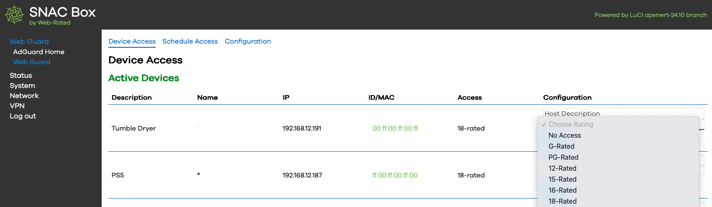

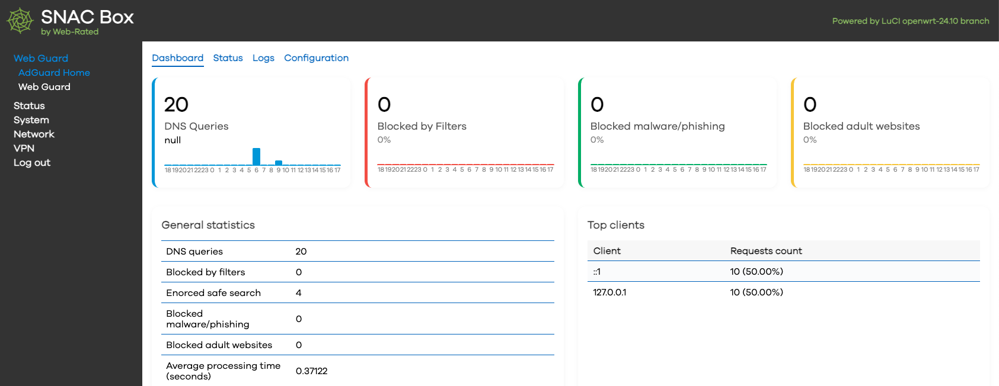

# Open Source Components
<h3>OpenWRT</h3> - https://openwrt.org/<br>
    The OpenWrt Project is a Linux operating system targeting embedded devices to create an router. <br>
<h3>AdguardHome</h3> - https://github.com/AdguardTeam/AdGuardHome<br>
    Free and open source, powerful network-wide ads & trackers blocking DNS server.<br>
<h3>Docker</h3> - https://www.docker.com/community/open-source/<br>
    Docker is built for developers, by developers. We enable team collaboration, efficient packaging, and scalable distribution of open-source projects, all with a focus on trust and security.<br>
<h3>e2Guardian</h3> - https://github.com/e2guardian/e2guardian<br>
    e2guardian is a content filtering proxy that can work in explicit and transparent proxy mode or as a ICAP server mode.<br>
<h3>Unbound</h3> - https://www.nlnetlabs.nl/projects/unbound/about/<br>
    Unbound is a validating, recursive, caching DNS resolver.<br>
<h3>PHP</h3> - https://www.php.net/<br>
    A popular general-purpose scripting language that is especially suited to web development. Fast, flexible and pragmatic, PHP powers everything from your blog to the most popular websites in the world.<br>

# Hardware

[Compatible Hardware](hardware.md)

# Fuctionality
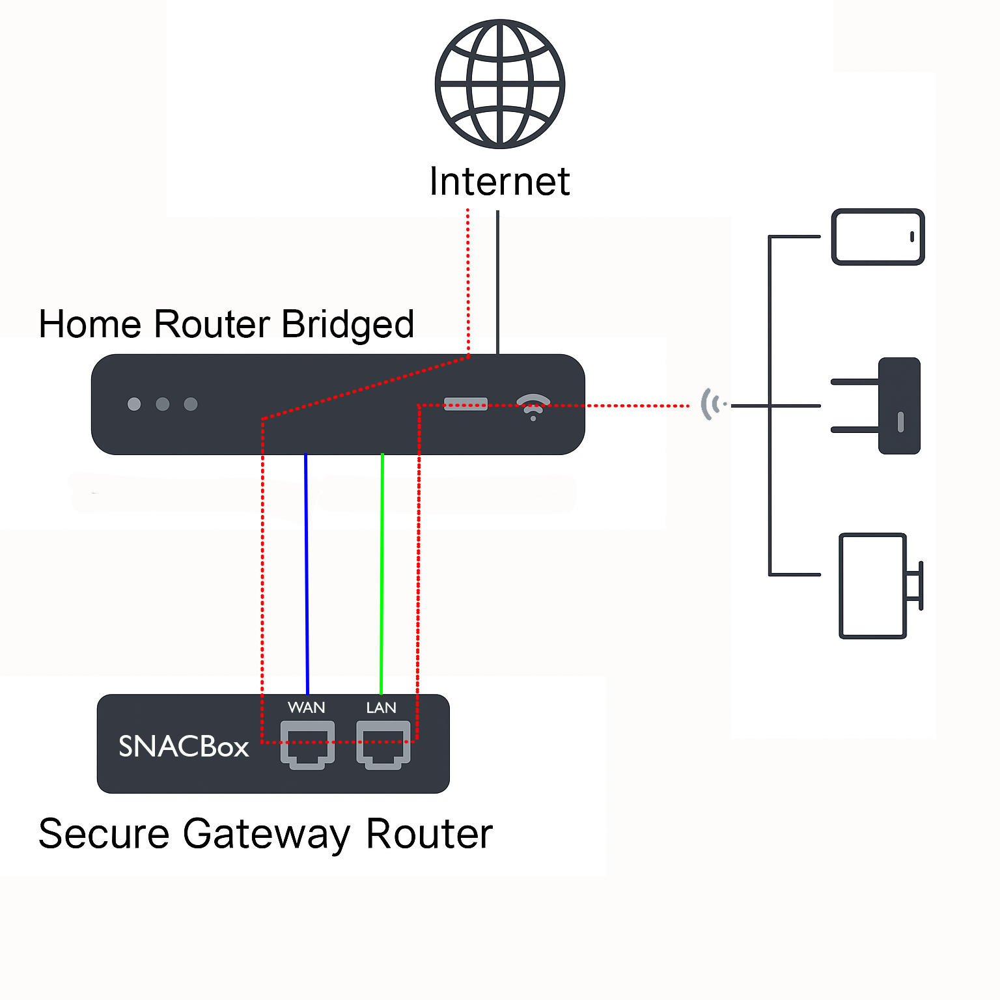

# Configurating SNACBox Dev Build
For the lates version goto the [Dev Build](https://github.com/AKrawczyk/SNACBox/blob/main/software/OpenWRT-Packages/webguard/readme.md).<br>

# Configurating SNACBox Release Build

Note: Only use on clean install of OpenWRT. These packages come with per-configured config file and will override existing config files.

<h2>Openwrt 25.12+ Firmware</h2>
Goto https://firmware-selector.openwrt.org<br>
Enter chosen hardware eg. "Raspberry Pi"<br>
Select based on the Hardware choice made e.g "Raspberry Pi 4B/400/CM4 (64bit)"<br>
Choose "Customize installed packages"<br>
Goto "Installed Packages"<br>
Add to the end of the list<br>

All hardware

```bash
 parted losetup resize2fs blkid php8 php8-cli php8-mod-curl luci-mod-rpc luci-ssl at jq adguardhome luci-base luci-theme-openwrt-2020 curl kmod-veth kmod-loop kmod-fuse
```

iPhone Teathering

```bash
kmod-usb-net-ipheth usbmuxd libimobiledevice usbutils libusbmuxd libplist
```

Goto "Script to run on first boot (uci-defaults)"

Add this resize script to resize the storage.

```bash
# Configure startup scripts
cat << "EOF" > /etc/uci-defaults/70-rootpt-resize
if [ ! -e /etc/rootpt-resize ] \
&& type parted > /dev/null \
&& lock -n /var/lock/root-resize
then
ROOT_BLK="$(readlink -f /sys/dev/block/"$(awk -e \
'$9=="/dev/root"{print $3}' /proc/self/mountinfo)")"
ROOT_DISK="/dev/$(basename "${ROOT_BLK%/*}")"
ROOT_PART="${ROOT_BLK##*[^0-9]}"
parted -f -s "${ROOT_DISK}" \
resizepart "${ROOT_PART}" 100%
mount_root done
touch /etc/rootpt-resize

if [ -e /boot/cmdline.txt ]
then 
NEW_UUID=`blkid ${ROOT_DISK}p${ROOT_PART} | sed -n 's/.*PARTUUID="\([^"]*\)".*/\1/p'`
sed -i "s/PARTUUID=[^ ]*/PARTUUID=${NEW_UUID}/" /boot/cmdline.txt
fi

reboot
fi
exit 1
EOF
cat << "EOF" > /etc/uci-defaults/80-rootfs-resize
if [ ! -e /etc/rootfs-resize ] \
&& [ -e /etc/rootpt-resize ] \
&& type losetup > /dev/null \
&& type resize2fs > /dev/null \
&& lock -n /var/lock/root-resize
then
ROOT_BLK="$(readlink -f /sys/dev/block/"$(awk -e \
'$9=="/dev/root"{print $3}' /proc/self/mountinfo)")"
ROOT_DEV="/dev/${ROOT_BLK##*/}"
LOOP_DEV="$(awk -e '$5=="/overlay"{print $9}' \
/proc/self/mountinfo)"
if [ -z "${LOOP_DEV}" ]
then
LOOP_DEV="$(losetup -f)"
losetup "${LOOP_DEV}" "${ROOT_DEV}"
fi
resize2fs -f "${LOOP_DEV}"
mount_root done
touch /etc/rootfs-resize
reboot
fi
exit 1
EOF
cat << "EOF" >> /etc/sysupgrade.conf
/etc/uci-defaults/70-rootpt-resize
/etc/uci-defaults/80-rootfs-resize
EOF
sh /etc/uci-defaults/70-rootpt-resize
```

Click "Request Build"<br>
Click and download "Factory (Ext4)"<br>

<h2>FLash SD Card</h2>
Get SD Card min 16GB<br>
Download and install Raspberry Pi imager https://www.raspberrypi.com/software/<br>
Insert SD card into computer or adapter<br>
Run Raspberry Pi Imager<br>
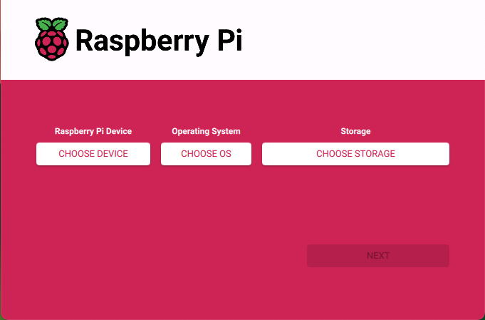<br>
Click "Select Hardware"
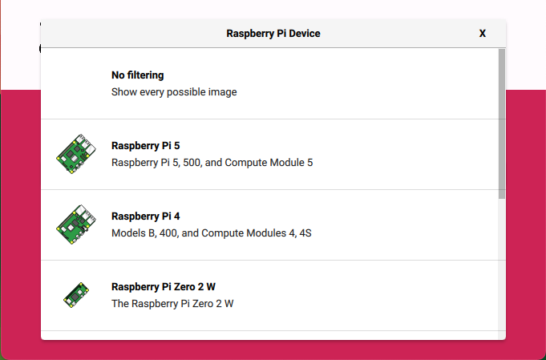<br>
Choose Hardware
<br>
Click "Select OS"
<br>
Choose "Custom Image"
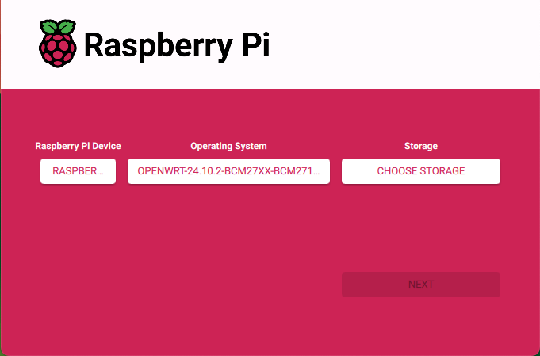<br>
Click "Select Storage"
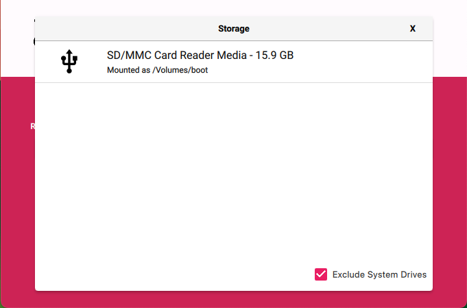<br>
Choose SD Card
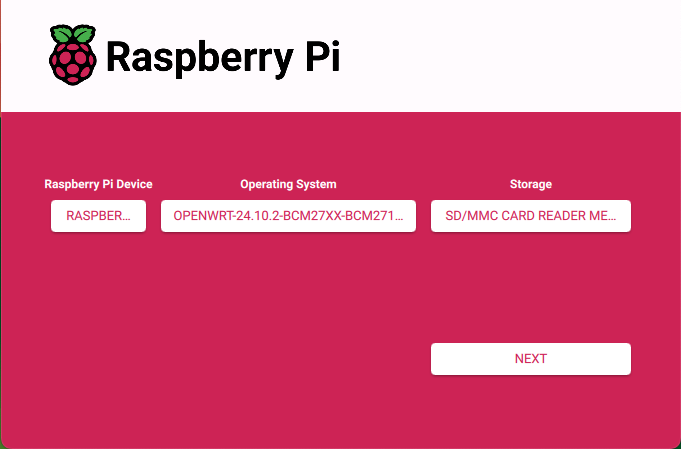<br>
Click "No" to customise OS
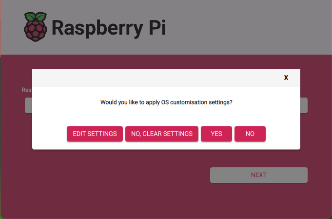<br>
Click "Complete"
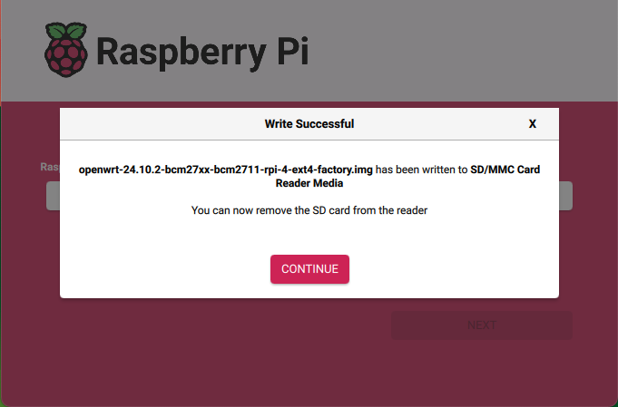<br>
Now the SD card is almost ready for use in the device<br>
Make sure you device is not connected to network or power
<h2>Boot OpenWRT 25.12+</h2>
Insert SD card into device<br>
Power on or Boot device<br>
Connect LAN port directly to a computer, the device will provide computer with new DHCP address<br>
Open web browser on computer and enter http://192.168.1.1 to access OpenWRT<br>
Configure OpenWRT Password<br>
SSH to root@192.168.1.1

```bash
ssh root@192.168.1.1
```

<h2>SNACBox Installation</h2>
The SNACBox APK packages are built for OpenWRT 25.12+.<br>
These packages are designed to create the SNACBox using a clean fresh install of OpenWRT.<br>
It is not recomended to run these packages on and existing OpenWRT instalation as it will overwrite firewall, network and AdGuardhome configurations.<br>
Test the network first:

```bash
nslookup downloads.openwrt.org
apk update
```

Install the three packages:

```bash
wget --no-check-certificate https://github.com/AKrawczyk/SNACBox/raw/refs/heads/main/software/OpenWRT-Packages/luci-app-adguardhome-plugin-1.0.0-r1.apk
wget --no-check-certificate https://github.com/AKrawczyk/SNACBox/raw/refs/heads/main/software/OpenWRT-Packages/luci-theme-openwrt-snacbox-1.0.0-r1.apk
wget --no-check-certificate https://github.com/AKrawczyk/SNACBox/raw/refs/heads/main/software/OpenWRT-Packages/luci-app-webguard-1.0.0-r1.apk
apk add --allow-untrusted luci-app-adguardhome-plugin-1.0.0-r1.apk luci-theme-openwrt-snacbox-1.0.0-r1.apk
service adguardhome restart
apk add --allow-untrusted luci-app-webguard-1.0.0-r1.apk
reboot
clear
```

After the box reboots you need to login to https://192.168.12.1 and ssh root@192.168.12.1 to verify and complete the configuration.<br>
The SNACBox is almost ready to be install on a Home Network Router and provide safe internet.<br>
Before using the SNACBox make sure you set the systems password.<br>
<h2>Set and Configure System Password</h2>
1. Goto 'System' -> 'Administration' -> 'Router Password'
<br>2. Enter new password
<br>3. Press 'Save'
<br>4. Goto 'Webguard' -> 'Web Access' -> 'Configuration'
<br>5. Enter the newly set password in the 'System Password' field.
<br>6. Press 'Save & Apply'<br>
<br>SNACBox is ready to be setup for use on a home network.

# Setup SNACBox on Home Network Router
Note: This is setup currently requires simple IT skills.<br>
<h2>Step 1</h2>
Connect SNACBox WAN port to Home Router<br>
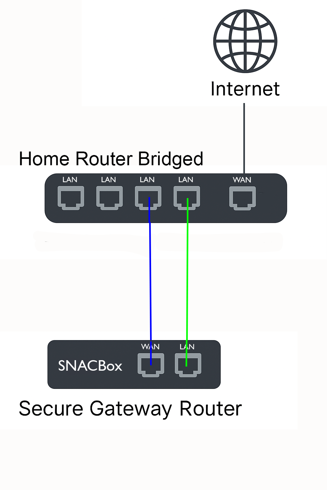
1. Power on SNACBox
<br>2. Connect one of the Home Routers Network ports to the SNACBox WAN port
<br>3. Connect the SNACBox LAN port to USB Network Dongles network port
<br>4. Connect the USB Network Dongles usb port to Laptop/Tablet/Smart Phone usb port
<br>5. Browse to https://192.168.12.1
<br>6. Login to SNACBox, User = root, Password = xxxxxx
<br>
<h3>Configure Static WAN IP</h3>
Goto Webguard -> Web Access
<br>Select 'Configure'
<br>Click button 'Reset WAN'
<br>
<h3>Setup Admin USB Network Dongle</h3>
Goto Webguard -> Web Access
<br>Select 'Device Access'
<br>Now set the Rating to '18-Rated' for the admin usb network dongle<br>


<h3>Enable SNACBox on Home Router</h3>
1. Disconnect USB Network Dongle from Laptop/Tablet/Smart Phone
<br>2. Disconnect SNACBox LAN port into USB Network Dongle
<br>
<br><strong>3. Login to Home Router and disable DHCP</strong>
<br>Note: Consult Home Router suppliers web page for information on how to do this.
<br>Note: DNS configuration my be necessary if Home Router is set to secure DNS
<br>
<br>4. Connect SNACBox LAN port to Home Router Network port
<h2>Step 2</h2>
Setup Admin devices<br>
Connect at least two wireless devices (Computer, Tablet, Smart Phone) to Home WiFi<br>
If your using a mobile device IOS, MacOS or Android make sure to configure the WiFi connection's Private Wi-Fi Address to 'Fixed'<br>

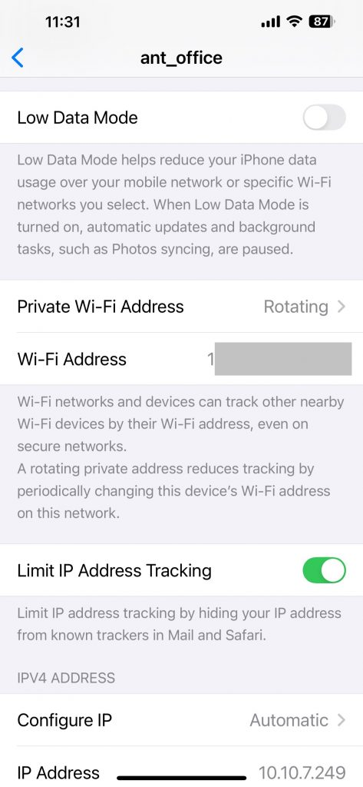<br>
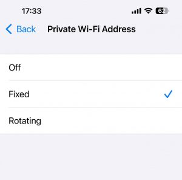

Note: These devices will automaticly be enroled into the 'No Access' rating<br>
<br>
1. Open Web browser and goto http://192.168.12.1<br>
2. Login to SNACBox, User = root, Password = xxxxxx
3. Now set the Rating to '18-Rated' for both admin devices<br>


4. Once the admin devices have been enabled proceed to step 3 to enable security and set time.
<h2>Step 3</h2>
<h3>Enable SNACBox security</h3>
Goto Webguard -> Web Access<br>
select 'Configure'<br>
Thick 'Enable Enhanced Security'<br>
<h3>Set Time</h3>
Click on 'System -> System'<br>
Find 'Timezone' dropdown list<br>
Select the correct timezone<br>

<h2>Device Setup</h2>
Now everthing should be setup and all devices connected to the Home WiFi should be appearing in the 'Device Access' web interface. All devices will automaticly be enroled into the 'No Access' rating<br><br>
1. Enable devices on home newtork<br>
2. https://192.168.12.1 -> Web Guard -> Web Access -> Device Access<br>
3. All devices trying to access the Home WiFi will have 'No Access' rating automaticly applied to them, but will have a 'Captive Portal' webpage appear showing there IP address.<br>

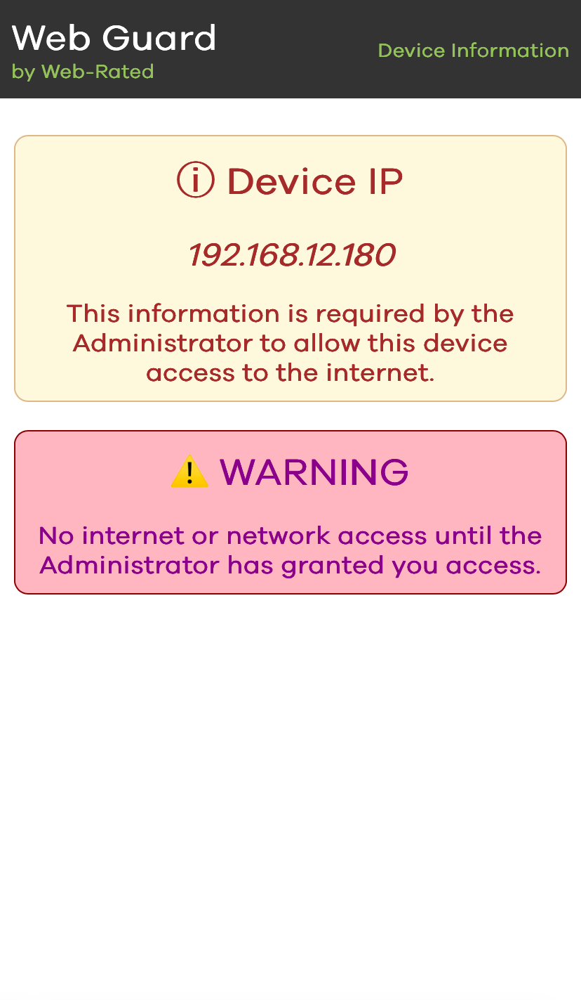<br>

4. Now find that device on the list of devices in 'Device Access' and assign it the necessary access rights (G, PG, 12, 15, 16 or 18).<br>
    The PDF contains detailed information regarding age rated filter configuration <a href="SNACBox%20Age%20Rated%20Filters.pdf">SNACBox Age Rated Filters.pdf</a>


