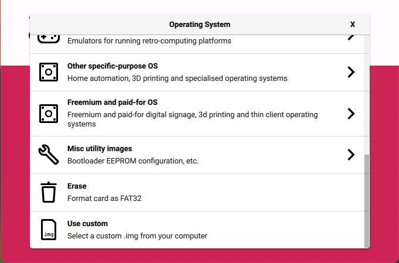

# $${\color{red} Note: Dev-Build-1.0}$$ #
## Mannual Installation of WebGuard ##

<h2>Openwrt 25.12+ Firmware</h2>
Goto https://firmware-selector.openwrt.org<br>
Enter chosen hardware eg. "Raspberry Pi"<br>
Select based on the Hardware choice made e.g "Raspberry Pi 4B/400/CM4 (64bit)"<br>
Choose "Customize installed packages"<br>
Goto "Installed Packages"<br>
Add to the end of the list<br>

All hardware

```bash
 parted losetup resize2fs blkid php8 php8-cli php8-mod-curl luci-mod-rpc luci-ssl at jq adguardhome luci-base luci-theme-openwrt-2020 curl kmod-veth kmod-loop kmod-fuse
```

iPhone Teathering

```bash
kmod-usb-net-ipheth usbmuxd libimobiledevice usbutils libusbmuxd libplist
```

Goto "Script to run on first boot (uci-defaults)"

Add this resize script to resize the storage.

```bash
# Configure startup scripts
cat << "EOF" > /etc/uci-defaults/70-rootpt-resize
if [ ! -e /etc/rootpt-resize ] \
&& type parted > /dev/null \
&& lock -n /var/lock/root-resize
then
ROOT_BLK="$(readlink -f /sys/dev/block/"$(awk -e \
'$9=="/dev/root"{print $3}' /proc/self/mountinfo)")"
ROOT_DISK="/dev/$(basename "${ROOT_BLK%/*}")"
ROOT_PART="${ROOT_BLK##*[^0-9]}"
parted -f -s "${ROOT_DISK}" \
resizepart "${ROOT_PART}" 100%
mount_root done
touch /etc/rootpt-resize

if [ -e /boot/cmdline.txt ]
then 
NEW_UUID=`blkid ${ROOT_DISK}p${ROOT_PART} | sed -n 's/.*PARTUUID="\([^"]*\)".*/\1/p'`
sed -i "s/PARTUUID=[^ ]*/PARTUUID=${NEW_UUID}/" /boot/cmdline.txt
fi

reboot
fi
exit 1
EOF
cat << "EOF" > /etc/uci-defaults/80-rootfs-resize
if [ ! -e /etc/rootfs-resize ] \
&& [ -e /etc/rootpt-resize ] \
&& type losetup > /dev/null \
&& type resize2fs > /dev/null \
&& lock -n /var/lock/root-resize
then
ROOT_BLK="$(readlink -f /sys/dev/block/"$(awk -e \
'$9=="/dev/root"{print $3}' /proc/self/mountinfo)")"
ROOT_DEV="/dev/${ROOT_BLK##*/}"
LOOP_DEV="$(awk -e '$5=="/overlay"{print $9}' \
/proc/self/mountinfo)"
if [ -z "${LOOP_DEV}" ]
then
LOOP_DEV="$(losetup -f)"
losetup "${LOOP_DEV}" "${ROOT_DEV}"
fi
resize2fs -f "${LOOP_DEV}"
mount_root done
touch /etc/rootfs-resize
reboot
fi
exit 1
EOF
cat << "EOF" >> /etc/sysupgrade.conf
/etc/uci-defaults/70-rootpt-resize
/etc/uci-defaults/80-rootfs-resize
EOF
sh /etc/uci-defaults/70-rootpt-resize
```

Click "Request Build"<br>
Click and download "Factory (Ext4)"<br>

<h2>FLash SD Card</h2>
Get SD Card min 16GB<br>
Download and install Raspberry Pi imager https://www.raspberrypi.com/software/<br>
Insert SD card into computer or adapter<br>
Run Raspberry Pi Imager<br>
<br>
Click "Select Hardware"
<br>
Choose Hardware
<br>
Click "Select OS"
<br>
Choose "Custom Image"
<br>
Click "Select Storage"
<br>
Choose SD Card
<br>
Click "No" to customise OS
<br>
Click "Complete"
<br>
Now the SD card is almost ready for use in the device<br>
Make sure you device is not connected to network or power
<h2>Boot OpenWRT 25.12+</h2>
Insert SD card into device<br>
Power on or Boot device<br>
Connect LAN port directly to a computer, the device will provide computer with new DHCP address<br>
Open web browser on computer and enter http://192.168.1.1 to access OpenWRT<br>
Configure OpenWRT Password<br>
SSH to root@192.168.1.1

```bash
ssh root@192.168.1.1
```

<h2>SNACBox Installation</h2>
Note: This is the test build of the luci-app-webguard APK package for OpenWRT 25.12+</br>
If you wish to install the WebGuard app mannualy the download the three shell script files.<br>

Run the scripts:

```bash
wget https://github.com/AKrawczyk/SNACBox/raw/refs/heads/main/software/OpenWRT-Packages/luci-app-adguardhome-plugin-1.0.0-r1.apk
wget https://github.com/AKrawczyk/SNACBox/raw/refs/heads/main/software/OpenWRT-Packages/luci-theme-openwrt-snacbox-1.0.0-r1.apk
apk add --allow-untrusted luci-app-adguardhome-plugin-1.0.0-r1.apk luci-theme-openwrt-snacbox-1.0.0-r1.apk
wget https://github.com/AKrawczyk/SNACBox/raw/refs/heads/main/software/OpenWRT-Packages/webguard/AdGuard-configure.sh
wget https://github.com/AKrawczyk/SNACBox/raw/refs/heads/main/software/OpenWRT-Packages/webguard/webguard-install.sh
wegt https://github.com/AKrawczyk/SNACBox/raw/refs/heads/main/software/OpenWRT-Packages/webguard/webguard-configure.sh
chmod +x webguard*.sh
chord +x AdGuard*.sh
./AdGuard-configure.sh
./webguard-install.sh
./webguard-configure.sh
```

This will install all the comopnents and configureations needed on a clean install of OpenWRT<br>
Note: only run AdGuard-configure.sh if you install the adguardhome plugin package.
